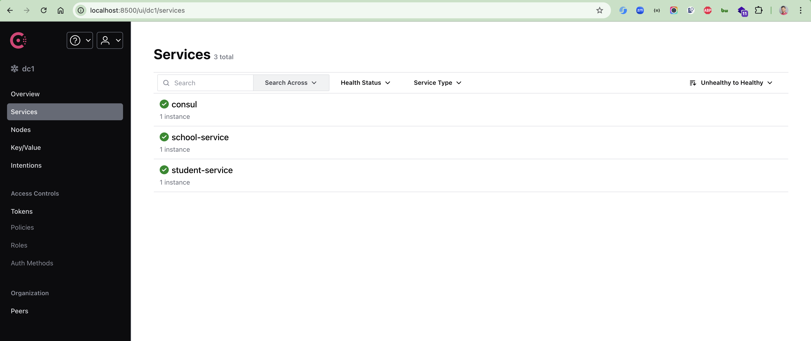
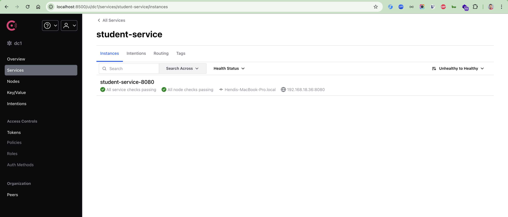
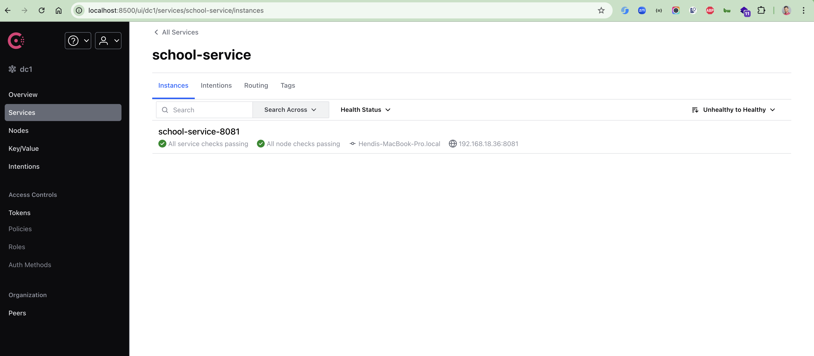
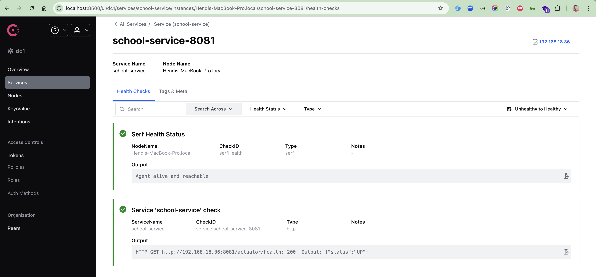

# spring-boot-consul-demo

[](https://github.com/hendisantika/spring-boot-consul-demo/actions/workflows/maven.yml)

Spring Boot Consul Demo: two microservices that register with HashiCorp Consul and find each other through service
discovery.

- **student-service** (port `8080`) returns the students of a school.
- **school-service** (port `8081`) looks up `student-service` in Consul and calls it with a `@LoadBalanced` `RestTemplate`.

### Tech Stack

- Java 25
- Spring Boot 4.1.1
- Spring Cloud 2025.1.3 (Consul Discovery)
- Maven
- Lombok

### Requirements

- JDK 25
- Maven 3.9+ (or use the included Maven wrapper `./mvnw`)
- Consul, running on `localhost:8500`

### Things todo list

1. Clone this repository: `git clone https://github.com/hendisantika/spring-boot-consul-demo.git`
2. Navigate to the folder: `cd spring-boot-consul-demo`
3. Run Consul, for example with Docker:
   `docker run -d --name consul -p 8500:8500 hashicorp/consul agent -dev -client=0.0.0.0`
4. Run the student service:
   ```shell
   cd student-service
   mvn clean spring-boot:run
   ```
5. In another terminal, run the school service:
   ```shell
   cd school
   mvn clean spring-boot:run
   ```
6. Open the Consul UI to see both services registered: http://localhost:8500
7. Open your favorite browser: http://localhost:8080/getStudentDetailsForSchool/Konoha
8. Open your favorite browser: http://localhost:8081/getSchoolDetails/Konoha

### Build

```shell
mvn -B package --file student-service/pom.xml
mvn -B package --file school/pom.xml
```

GitHub Actions builds both services on Temurin JDK 25 for every push and pull request to `main`.

### Image Screenshot

Consul Home Page



Student Service




School Service




